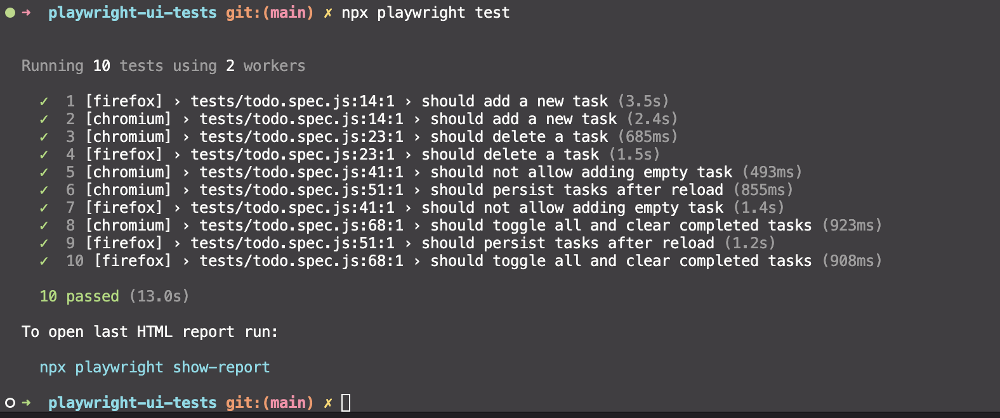
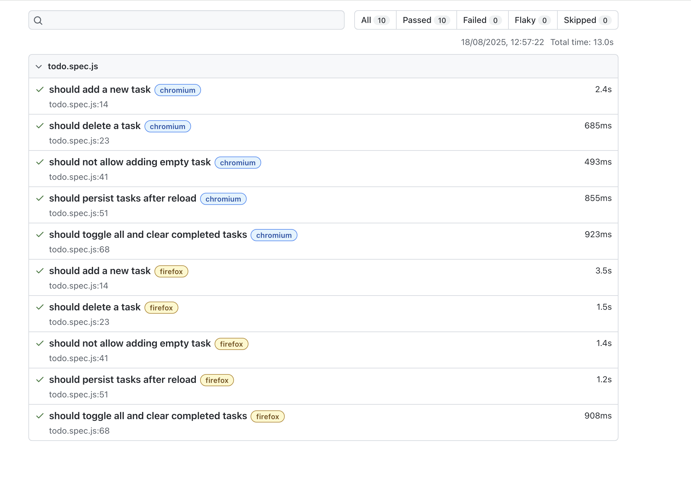

# Playwright UI Tests (TodoMVC)


A demo set of UI tests using [Playwright](https://playwright.dev/) for the [TodoMVC app](https://demo.playwright.dev/todomvc/).

## ✅ Test scenarios

- Add a new todo item
- Delete an existing todo item
- Prevent adding an empty todo
- Persist state after page reload (localStorage)
- Regression: toggle-all + clear completed

## 🛠 Stack

- Node.js
- [@playwright/test](https://playwright.dev/docs/intro)

## 🚀 Run locally

```bash
# 1) Install dependencies
npm install

# 2) Install Playwright browsers (once)
npx playwright install --with-deps

# 3) Run all tests
npm test

# 4) Open HTML report
npm run report
```

## 📸 Example run

Console run:  


## 📊 HTML Report

Sample HTML report:  

